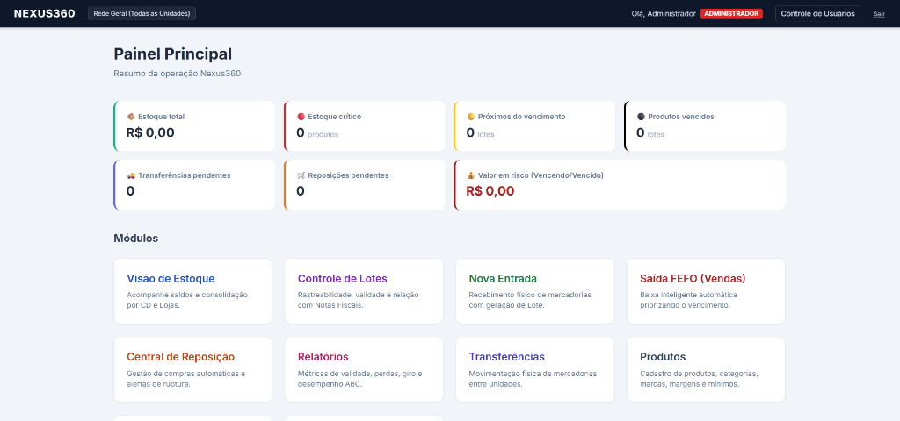
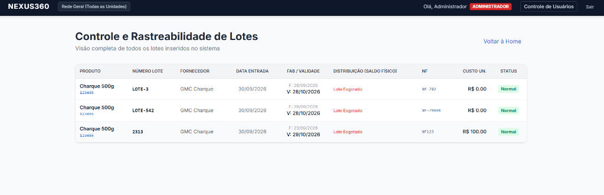
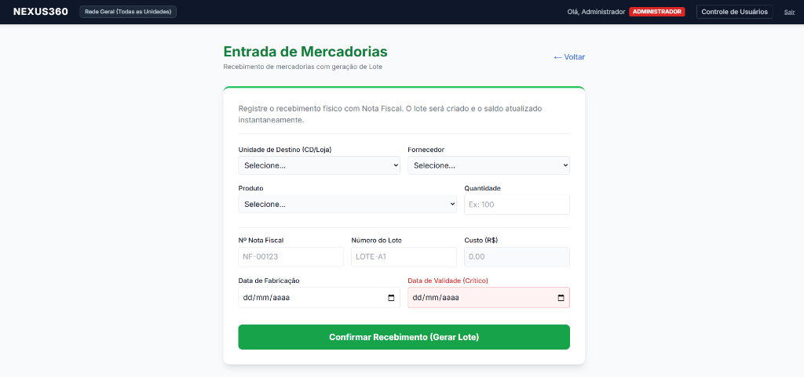
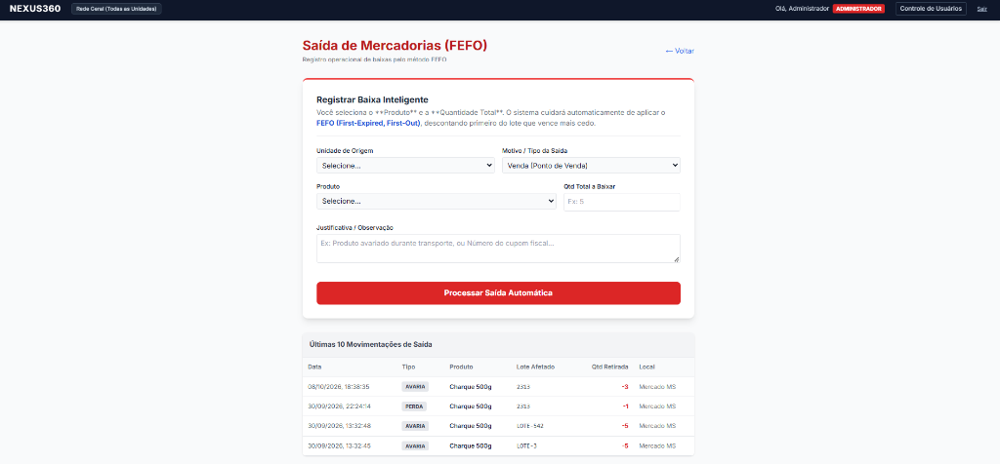
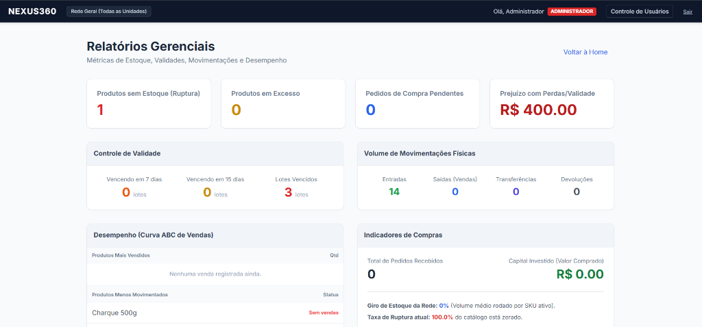
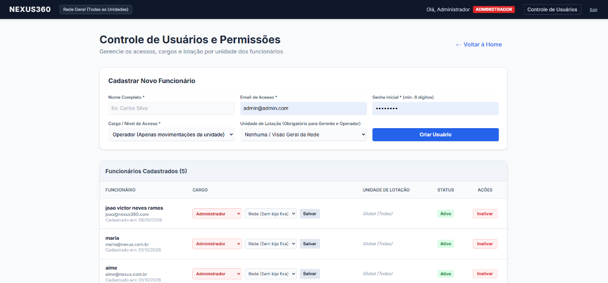

# Nexus360 - Gestão Integrada de Estoque e WMS

O **Nexus360** é um sistema web moderno e robusto para gestão inteligente de estoques, operações logísticas e controle de validades. Projetado sob medida para o varejo (com foco em redes de supermercados, lojas e centros de distribuição), o sistema oferece uma visão unificada da rede, isolamento de acessos por loja e automação do algoritmo **FEFO (First Expired, First Out)**.

<div align="center">
  
  <p><em>Painel Principal: KPIs em tempo real, lotes críticos, produtos vencidos e navegação integrada entre módulos.</em></p>
</div>

---

## Módulos do Sistema em Execução

<table width="100%">
  <tr>
    <td width="50%" valign="top">
      <h4 align="center">Controle e Rastreabilidade de Lotes</h4>
      
      <p align="center"><sub>Rastreabilidade ponta a ponta (Produto, NF, Lote, Validade e classificação visual de risco).</sub></p>
    </td>
    <td width="50%" valign="top">
      <h4 align="center">Entrada de Mercadorias</h4>
      
      <p align="center"><sub>Recebimento físico vinculado a Fornecedor, NF e geração instantânea de lote com validade.</sub></p>
    </td>
  </tr>
  <tr>
    <td width="50%" valign="top">
      <h4 align="center">Saída de Mercadorias (Algoritmo FEFO)</h4>
      
      <p align="center"><sub>Baixas inteligentes priorizando lotes de menor vencimento para erradicar perdas no varejo.</sub></p>
    </td>
    <td width="50%" valign="top">
      <h4 align="center">Relatórios Gerenciais e Indicadores</h4>
      
      <p align="center"><sub>Métricas analíticas de Curva ABC, taxa de ruptura, histórico de movimentações e cálculo de perdas.</sub></p>
    </td>
  </tr>
  <tr>
    <td colspan="2" width="100%" valign="top">
      <h4 align="center">Controle de Usuários e Permissões (RBAC)</h4>
      
      <p align="center"><sub>Gestão de acessos por perfil (Administrador, Gerente, Operador) e escopo de visualização por loja física ou matriz.</sub></p>
    </td>
  </tr>
</table>

---

## Principais Módulos

1. **Dashboard:** Painel principal com KPIs em tempo real (valor total em estoque, estoque crítico, lotes próximos do vencimento, produtos vencidos, transferências e reposições pendentes).
2. **Visão de Estoque:** Controle de saldos consolidados e detalhados fisicamente por cada Centro de Distribuição e Loja.
3. **Controle de Lotes e Validades:** Gestão de rastreabilidade (Produto → Lote → NF) com classificação visual de risco (Normal, Crítico, Vencido). *Lotes vencidos são bloqueados automaticamente para vendas e transferências.*
4. **Entrada de Mercadorias:** Recebimento físico atrelado a Nota Fiscal, Fornecedor e geração de Lote com data de fabricação e validade.
5. **Saída FEFO (Vendas/Baixas):** Baixas inteligentes que consomem automaticamente os lotes com vencimento mais próximo para eliminar perdas.
6. **Transferências entre Unidades:** Movimentação física de mercadorias entre CDs e Lojas com fluxo de solicitação, aprovação e recebimento atômico.
7. **Central de Reposição Inteligente:** Sugestão automática de compras e transferências baseada em estoque mínimo e histórico de consumo.
8. **Relatórios Gerenciais:** Métricas analíticas de curva ABC, giro, perdas e histórico de movimentações (livro-razão).
9. **Produtos (Cadastros Mestres):** Gestão de SKU, EAN, categorias, marcas, preços de custo/venda e estoques de segurança.
10. **Fornecedores:** Gestão de empresas parceiras, prazos de entrega e condições comerciais.
11. **CDs e Lojas (Unidades):** Estrutura física da rede (Centros de Distribuição e Pontos de Venda).
12. **Controle de Usuários e Permissões (`/usuarios`):** Módulo exclusivo para Administradores criarem novos funcionários, definirem cargos, vincularem lojas e ativarem/inativarem acessos em tempo real.

---

## Matriz de Permissões (RBAC) e Escopo por Unidade

O Nexus360 implementa um rigoroso controle de acesso baseado em funções (**Role-Based Access Control**) com Row Level Security (RLS) no PostgreSQL:

| Funcionalidade | Administrador | Gestor de Estoque | Gerente de Loja | Operador |
| :--- | :---: | :---: | :---: | :---: |
| **Dashboard** | Global | Global | Loja vinculada | Loja vinculada |
| **Produtos, Fornecedores e Unidades** | Criar / Editar / Excluir | Somente Leitura | Somente Leitura | Somente Leitura |
| **Saldos e Lotes** | Toda a Rede | Toda a Rede | Loja vinculada | Loja vinculada |
| **Entradas de Mercadorias** | Qualquer unidade | Histórico | Loja vinculada | Loja vinculada |
| **Saídas FEFO** | Qualquer unidade | Histórico | Histórico | Loja vinculada |
| **Transferências** | Criar / Aprovar | Criar / Aprovar | Criar / Aprovar (Sua Loja) | Histórico (Sua Loja) |
| **Central de Reposição** | Criar / Aprovar | Criar / Aprovar | Solicitar (Sua Loja) | Sem acesso |
| **Relatórios** | Todos | Todos | Loja vinculada | Sem acesso |
| **Controle de Usuários (`/usuarios`)** | Exclusivo | Sem acesso | Sem acesso | Sem acesso |

### Regra de Ouro: Integridade do Estoque
Nenhum usuário (inclusive o Administrador) pode alterar manualmente o número do estoque em formulários diretos. Toda alteração de saldo é rastreável e auditada via transações oficiais: **Entradas**, **Saídas FEFO** e **Transferências**.

---

## Tecnologias Utilizadas

- **Frontend:** [Next.js 14](https://nextjs.org/) (App Router, Server Actions, Server Components).
- **Estilização:** [Tailwind CSS](https://tailwindcss.com/) com design system responsivo.
- **Backend / Banco de Dados:** [Supabase](https://supabase.com/) (PostgreSQL, Triggers, RPCs em PL/pgSQL, Row Level Security - RLS).
- **Autenticação:** Supabase Auth com gerenciamento de sessão via `@supabase/ssr`.
- **Linguagem:** TypeScript com tipagem estrita.
- **Deploy:** [Vercel](https://vercel.com/).

---

## Configuração e Execução

### 1. Variáveis de Ambiente (`.env.local`)
Crie o arquivo `.env.local` na raiz do projeto:

```env
NEXT_PUBLIC_SUPABASE_URL=https://seu-projeto.supabase.co
NEXT_PUBLIC_SUPABASE_ANON_KEY=sua-anon-key-aqui
SUPABASE_SERVICE_ROLE_KEY=sua-service-role-key-aqui
```

> **Nota:** A `SUPABASE_SERVICE_ROLE_KEY` é necessária exclusivamente para o Administrador poder provisionar novos usuários no módulo `/usuarios`.

### 2. Migrações de Banco de Dados
Para aplicar o esquema completo e as políticas de segurança:
1. Acesse o **SQL Editor** no painel do Supabase.
2. Execute o arquivo base: `supabase/migrations/20260930_initial_schema.sql`
3. Execute a migração de RBAC e escopo por unidade: `supabase/migrations/20261001_rbac_and_unit_scope.sql`

### 3. Rodando Localmente
```bash
npm install
npm run dev
```
Acesse `http://localhost:3000`.

---

## Contas Padrão para Testes

Após a execução das migrações, você pode acessar com:

- **Administrador:**
  - **E-mail:** `admin@admin.com`
  - **Senha:** `admin123`
- **Operador:**
  - Cadastrado via tela de login ou pelo painel do Administrador em **Controle de Usuários**.

---

Desenvolvido por **[Daniel Martins](https://github.com/danmrtx)**.
